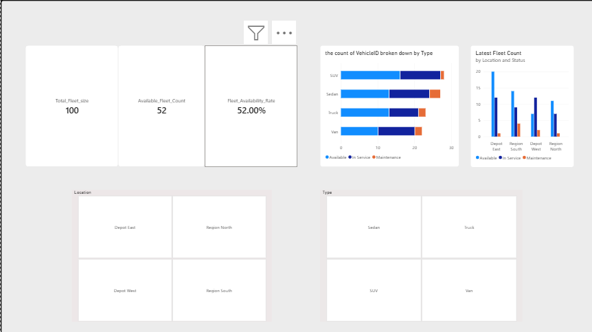

# Car Fleet Availability Management Solution

## Overview
This repository contains my first Business Intelligence project built in Microsoft Power BI. The solution is a single-page interactive dashboard designed to monitor vehicle availability, operational status, and fleet distribution across locations and vehicle types.

*Note: All datasets included in this repository are synthetically generated for learning, data modeling, and portfolio demonstration purposes.*

---

## Dashboard Preview


---

## Repository Structure
```text
car_fleet_dashboard_project/
├── data/                   # Simulated Excel datasets (Vehicles & Status Logs)
├── report/                 # Power BI Desktop report file (.pbix)
├── assets/                 # Dashboard screenshot for documentation
└── README.md               # Project documentation
```

---

## Data Model & Schema
The semantic model connects two tables using a one-to-many relationship on `VehicleID`:

* **Vehicle Master Table (Dimension):** Contains 100 unique vehicles (`V101` to `V200`) with attributes including `VehicleID`, `VIN`, `Make`, `Model`, `Type` (Sedan, SUV, Truck, Van), `Location` (Depot East, Depot West, Region North, Region South), and `PurchaseDate`.
* **Status Log Table (Fact):** Contains 138 historical status entries (`L501` to `L638`) tracking `LogID`, `VehicleID`, `Status` (Available, In Service, Maintenance), `StatusChangeDate`, and operational `Comments`.

---

## Key Metrics & Visuals
The single-page report canvas features the following KPIs, charts, and interactive filters:

* **KPI Cards:**
  * **Total Fleet Size:** Distinct count of vehicles in the selected scope.
  * **Available Fleet Count:** Count of vehicles whose most recent status log is marked as `Available`.
  * **Fleet Availability Rate:** Percentage of the total fleet currently available for deployment.
* **Breakdown Visuals:**
  * **Fleet Status by Vehicle Type:** A 100% stacked bar chart comparing operational status proportions across vehicle categories.
  * **Latest Fleet Count by Location and Status:** A clustered column chart displaying the latest status distribution across depots and regions.
* **Interactive Slicers:**
  * Tile slicers for **Location** and **Type** enabling dynamic cross-filtering across all KPI cards and charts.

---

## DAX Measures
To prevent double-counting vehicles with multiple historical log entries, the model evaluates the latest `StatusChangeDate` per vehicle:

```dax
Total Fleet Size = DISTINCTCOUNT('Vehicles'[VehicleID])

Latest Fleet Count = 
CALCULATE(
    DISTINCTCOUNT('StatusLogs'[VehicleID]),
    FILTER(
        'StatusLogs',
        'StatusLogs'[StatusChangeDate] = CALCULATE(MAX('StatusLogs'[StatusChangeDate]))
    )
)

Available Fleet Count = 
CALCULATE(
    [Latest Fleet Count],
    'StatusLogs'[Status] = "Available"
)

Fleet Availability Rate = 
DIVIDE([Available Fleet Count], [Total Fleet Size], 0)
```

---

## How to Run Locally
1. **Clone the Repository:**
   ```bash
   git clone https://github.com
   ```
2. **Open in Power BI Desktop:**
   Navigate to the `report/` directory and open the `.pbix` file.
3. **Update Data Source Path:**
   * In the top ribbon, go to **Home > Transform data > Data source settings**.
   * Update the file path to point to your local `data/` folder.
   * Click **Close & Apply** to refresh the visuals.

---

## Tools & Technologies
* **Microsoft Power BI Desktop:** Data modeling, DAX measure creation, and report design.
* **Microsoft Excel:** Source data storage.
* **Git & GitHub:** Version control and project documentation.
